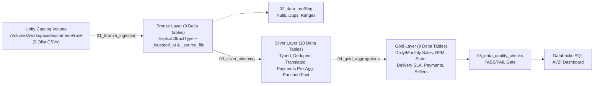

# E-Commerce Customer Behaviour & Sales Intelligence

A production-style **Medallion Lakehouse** Data Engineering project built with **Python, PySpark, Delta Lake, and Databricks Unity Catalog** using the [Olist Brazilian E-Commerce Public Dataset](https://www.kaggle.com/datasets/olistbr/brazilian-ecommerce) (9 relational CSV tables, ~100K orders).

---

## 1. Problem Statement

Marketplace leadership needs a single, trusted analytics platform to answer high-impact commercial and operational questions:
- **Revenue & Growth**: How are daily/monthly GMV, order volume, AOV, and MoM revenue growth trending?
- **Customer Retention (RFM)**: Which customers are *Champions* vs. *At Risk* or *Lost*, and what drives repeat purchasing?
- **Logistics & Customer Satisfaction**: How severely do late deliveries across Brazilian states degrade customer review scores?
- **Merchandising, Payments & Sellers**: Which English product categories, payment methods (installments vs. boleto), and sellers generate the majority of revenue and customer satisfaction?

Raw Olist exports contain duplicate review IDs, ~1M redundant geolocation rows, multi-row payments that cause join fan-out, untranslated/null product categories, multiline quoted review text, and mixed order statuses. This project solves those challenges end-to-end with schema enforcement, idempotent Delta tables, automated data quality gates, workflow orchestration, and a Databricks SQL dashboard layer.

---

## 2. Architecture Diagram



For full architectural rationale and design trade-offs, see [`docs/architecture.md`](docs/architecture.md).

---

## 3. Tech Stack

| Component | Technology |
| :--- | :--- |
| **Compute & Processing** | Apache Spark / PySpark (Databricks Runtime 15.4 LTS) |
| **Storage & Table Format** | Delta Lake (ACID transactions, schema enforcement, idempotent overwrites) |
| **Governance & Storage** | Databricks Unity Catalog (Catalog, Schema, Managed Volumes) |
| **Orchestration** | Databricks Workflows (`workflows/job_definition.json`) |
| **BI & Visualization** | Databricks SQL / AI/BI (Lakeview) Dashboards |
| **Testing & Quality** | `pytest` (local `SparkSession`), automated SQL/PySpark DQ Gate |

---

## 4. Repository Structure

```text
ecommerce-data-engineering/
├── README.md
├── requirements.txt
├── config/
│   ├── __init__.py
│   └── config.py                     # Single source of truth for paths, catalog, schema, tables
├── notebooks/
│   ├── 00_setup.py                   # Create Unity Catalog schema/volume & verify 9 raw CSVs
│   ├── 01_bronze_ingestion.py        # Explicit StructType CSV -> 9 Bronze Delta tables
│   ├── 02_data_profiling.py          # Nulls, key duplicates, status mix, numeric & join diagnostics
│   ├── 03_silver_cleaning.py         # Clean, cast, dedup, translate, pre-agg payments -> 10 Silver tables
│   ├── 04_gold_aggregations.py       # 9 Gold business marts with groupBy/agg & Window functions
│   └── 05_data_quality_checks.py     # PASS/FAIL validation gate (fails fast on critical errors)
├── sql/
│   └── dashboard_queries.sql         # Parameterized Databricks SQL queries (1 per dashboard visual)
├── workflows/
│   └── job_definition.json           # Databricks Multi-Task Workflow: 01 -> 03 -> 04 -> 05
├── docs/
│   ├── architecture.md               # Medallion design & Mermaid architecture diagrams
│   ├── data_dictionary.md            # Full Bronze, Silver, and Gold table/column definitions
│   └── insights.md                   # Executive insights report template to complete post-run
└── tests/
    └── test_transformations.py       # Pytest unit tests for Silver & Gold logic (local Spark)
```

---

## 5. How to Run on Databricks (Step by Step)

### Step 1: Import Repository into Databricks
1. Open your Databricks workspace → **Workspace** → **Git Folders (Repos)** → **Add Git Folder**.
2. Clone this repository (or upload the `ecommerce-data-engineering/` folder directly into `/Workspace/Repos/ecommerce-data-engineering`).

### Step 2: Configure Namespace & Path (Optional)
- Open [`config/config.py`](config/config.py). By default:
  - `CATALOG = "workspace"`
  - `SCHEMA = "ecommerce"`
  - `RAW_DATA_PATH = "/Volumes/workspace/ecommerce/raw/"`
- Override either in `config/config.py` or via cluster environment variables (`ECOMMERCE_CATALOG`, `ECOMMERCE_SCHEMA`, `ECOMMERCE_RAW_DATA_PATH`).

### Step 3: Run One-Time Environment Setup
1. Attach [`notebooks/00_setup.py`](notebooks/00_setup.py) to a Unity Catalog-enabled cluster (DBR 15.4 LTS or Serverless).
2. Run all cells to create `workspace.ecommerce` and `/Volumes/workspace/ecommerce/raw/`.

### Step 4: Upload the 9 Olist CSV Files
1. Download the [Olist Brazilian E-Commerce Dataset from Kaggle](https://www.kaggle.com/datasets/olistbr/brazilian-ecommerce).
2. In Databricks **Catalog Explorer**, navigate to `workspace` → `ecommerce` → `Volumes` → `raw` and upload all 9 CSV files:
   - `olist_orders_dataset.csv`
   - `olist_order_items_dataset.csv`
   - `olist_order_payments_dataset.csv`
   - `olist_order_reviews_dataset.csv`
   - `olist_customers_dataset.csv`
   - `olist_products_dataset.csv`
   - `olist_sellers_dataset.csv`
   - `olist_geolocation_dataset.csv`
   - `product_category_name_translation.csv`
3. Re-run `notebooks/00_setup.py` to confirm `Files Found: 9 / 9`.

### Step 5: Execute the Pipeline
- **Interactive Run (Notebook by Notebook)**:
  1. `notebooks/01_bronze_ingestion.py` — Ingests all 9 CSVs into Bronze Delta tables.
  2. `notebooks/02_data_profiling.py` — *(Optional exploratory step)* Inspects nulls, duplicates, and anomalies.
  3. `notebooks/03_silver_cleaning.py` — Cleans, deduplicates, enriches, and verifies post-join row counts.
  4. `notebooks/04_gold_aggregations.py` — Builds all 9 Gold analytical tables.
  5. `notebooks/05_data_quality_checks.py` — Runs the PASS/FAIL Data Quality gate.
- **Automated Orchestration (Databricks Workflows)**:
  - Import [`workflows/job_definition.json`](workflows/job_definition.json) via the Databricks CLI:
    ```bash
    databricks jobs create --json @workflows/job_definition.json
    ```
  - Or paste the JSON in **Workflows → Jobs → Create Job → Edit as JSON**.
  - The DAG runs `01_bronze_ingestion` → `03_silver_cleaning` → `04_gold_aggregations` → `05_data_quality_checks`.

### Step 6: Build the Databricks SQL Dashboard
1. Open **Databricks SQL → Dashboards → Create AI/BI Dashboard**.
2. Create datasets from [`sql/dashboard_queries.sql`](sql/dashboard_queries.sql) and arrange the visuals per the layout below.
3. Populate [`docs/insights.md`](docs/insights.md) with your resulting metrics.

---

## 6. Table Descriptions

### Bronze Layer (Raw + Lineage)
- `bronze_orders`, `bronze_order_items`, `bronze_order_payments`, `bronze_order_reviews`, `bronze_customers`, `bronze_products`, `bronze_sellers`, `bronze_geolocation`, `bronze_category_translation`
- Every table uses an explicit `StructType` schema and adds `_ingested_at` and `_source_file`.

### Silver Layer (Conformed & Enriched)
- `silver_orders` — Delivered orders with typed timestamps and derived `delivery_days`, `delay_days`, `is_late`, `order_year`, `order_month`, `year_month`.
- `silver_orders_non_delivered` — Canceled, unavailable, shipped, and in-progress orders isolated from commercial KPIs.
- `silver_order_items` — Deduplicated items (`price >= 0`, `freight_value >= 0`) with derived `item_total = price + freight_value`.
- `silver_order_payments` — Order-grain payment summary (`total_payment_value`, `max_installments`, `primary_payment_type`) preventing join fan-out.
- `silver_order_reviews` — Deduplicated by `review_id` (latest answer/creation timestamp).
- `silver_customers`, `silver_sellers` — Deduplicated with standardized casing and 5-char zero-padded zip prefixes.
- `silver_products` — Null categories imputed to `"unknown"`, typos fixed, joined with English `category_en`.
- `silver_geolocation` — Deduplicated by zip prefix using average latitude/longitude.
- `silver_orders_enriched` — Conformed `(order_id, order_item_id)` analytical fact joining all Silver entities with automated row-count preservation assertion.

### Gold Layer (Business Marts)
| Table | Grain | Key Metrics |
| :--- | :--- | :--- |
| `gold_daily_sales` | `order_date` | `orders`, `revenue`, `aov`, `freight` |
| `gold_monthly_sales` | `year_month` | `revenue`, `orders`, `mom_growth_pct` (`lag` window) |
| `gold_category_performance` | `category_en` | `units`, `revenue`, `avg_price`, `avg_review` |
| `gold_customer_rfm` | `customer_unique_id` | `recency_days`, `frequency`, `monetary`, `r/f/m_score` (`ntile(5)`), `rfm_segment` |
| `gold_state_sales` | `state` | `orders`, `revenue`, `customers` |
| `gold_delivery_performance` | `state` | `avg_delivery_days`, `avg_delay_days`, `pct_late`, `avg_review` |
| `gold_payment_mix` | `payment_type` | `orders`, `revenue`, `avg_installments` |
| `gold_seller_performance` | `seller_id` | `revenue`, `orders`, `avg_review` |
| `gold_review_vs_delay` | `delay_bucket` | `avg_review`, `orders` (`On Time`, `1-3`, `4-7`, `8+` days late) |

See [`docs/data_dictionary.md`](docs/data_dictionary.md) for column-level types and business definitions.

---

## 7. Key Performance Indicators (KPIs)

- **Total Revenue (GMV)**: `SUM(item_total)` across delivered orders (reconciled between Silver and Gold).
- **Total Orders**: `COUNT(DISTINCT order_id)` for delivered orders.
- **Average Order Value (AOV)**: `Total Revenue / Total Orders`.
- **Unique Customers**: `COUNT(DISTINCT customer_unique_id)`.
- **Late Delivery Rate (% Late)**: Percentage of delivered orders with `delay_days > 0` (`order_delivered_customer_date > order_estimated_delivery_date`).
- **Average Review Score**: Mean order-level customer satisfaction score (`1.00` – `5.00`).
- **Month-over-Month Growth (%)**: `((current_month_revenue - prior_month_revenue) / prior_month_revenue) * 100`.

---

## 8. Dashboard Layout & Filters

Queries live in [`sql/dashboard_queries.sql`](sql/dashboard_queries.sql).

### Global Dashboard Filters (Top Bar)
1. **Date Range** (`order_date` / `year_month`): Slices KPI counters and sales time series.
2. **State** (`customer_state` / `state`): Multi-select 2-letter Brazilian UF filter (`SP`, `RJ`, `MG`, etc.).
3. **Category** (`category_en`): Multi-select English product category filter.

### Recommended 4-Row Layout
- **Row 1 — Executive KPI Strip**: 6 counter tiles (*Total Revenue*, *Total Orders*, *AOV*, *Unique Customers*, *% Late Deliveries*, *Avg Review Score*).
- **Row 2 — Growth & Geography**: *Monthly Revenue Trend & MoM Growth %* (dual-axis bar + line chart) alongside *Revenue & SLA by Brazilian State* (choropleth map + hover tooltips).
- **Row 3 — Customer & Logistics Intelligence**: *RFM Segment Distribution* (treemap / stacked bar showing customer & revenue share across *Champions, Loyal, Potential Loyalist, At Risk, Lost*) alongside *Delivery Delay Bucket vs. Review Score* (combo bar + line chart).
- **Row 4 — Merchandising, Payments & Sellers**: *Top 10 Categories by Revenue*, *Payment Mix Breakdown* (donut + avg installments), and *Top 10 Sellers Leaderboard*.

---

## 9. Running Unit Tests Locally

```bash
pip install -r requirements.txt
pytest tests/test_transformations.py -v
```

Tests validate derived columns (`delivery_days`, `delay_days`, `is_late`, `item_total`), deduplication, payment pre-aggregation, post-join grain preservation, `lag`-based MoM growth, `ntile(5)` RFM segmentation, and delivery delay buckets using a local `SparkSession`.

---

## 10. Dashboard & Pipeline Screenshots

> Replace the placeholders below with actual screenshots after running the Databricks Workflow and publishing your SQL Dashboard.

| Databricks Workflow DAG | Data Quality PASS/FAIL Gate |
| :---: | :---: |
|  |  |

| Executive Sales & Geography Dashboard | RFM & Logistics Intelligence Dashboard |
| :---: | :---: |
|  |  |
