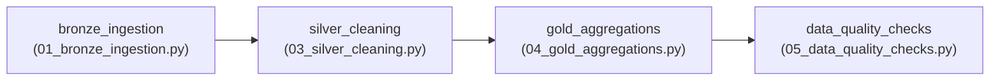

# Architecture — E-Commerce Customer Behaviour & Sales Intelligence

## 1. Medallion Lakehouse Overview

This platform implements a three-tier **Medallion Architecture** on **Databricks Unity Catalog** and **Delta Lake** over the Olist Brazilian E-Commerce dataset (9 relational CSV entities, ~100K orders).

```mermaid
flowchart LR
    subgraph Raw["Raw Landing Zone (Unity Catalog Volume)"]
        V["/Volumes/workspace/ecommerce/raw/<br/>9 Olist CSV Files"]
    end

    subgraph Bronze["Bronze Layer (Raw Delta Tables)"]
        B1["bronze_orders<br/>bronze_order_items<br/>bronze_order_payments"]
        B2["bronze_order_reviews<br/>bronze_customers<br/>bronze_products"]
        B3["bronze_sellers<br/>bronze_geolocation<br/>bronze_category_translation"]
    end

    subgraph Silver["Silver Layer (Conformed & Enriched Delta)"]
        S1["silver_orders (delivered)<br/>silver_orders_non_delivered"]
        S2["silver_order_items<br/>silver_order_payments (order-grain)<br/>silver_order_reviews (deduped)"]
        S3["silver_customers / silver_sellers<br/>silver_products (EN categories)<br/>silver_geolocation (avg lat/lng)"]
        SE["silver_orders_enriched<br/>(Order-Item Analytical Fact)"]
    end

    subgraph Gold["Gold Layer (Business Marts)"]
        G1["Sales Marts<br/>gold_daily_sales<br/>gold_monthly_sales<br/>gold_state_sales"]
        G2["Product & Seller Marts<br/>gold_category_performance<br/>gold_seller_performance<br/>gold_payment_mix"]
        G3["Customer & Logistics Marts<br/>gold_customer_rfm<br/>gold_delivery_performance<br/>gold_review_vs_delay"]
    end

    subgraph Governance["Quality & Consumption"]
        DQ["05_data_quality_checks<br/>(PASS/FAIL Gate)"]
        BI["Databricks SQL<br/>AI/BI Dashboard"]
    end

    V -->|"01_bronze_ingestion<br/>Explicit StructType + Audit Cols"| Bronze
    Bronze -.->|"02_data_profiling<br/>(Exploratory Diagnostics)"| Bronze
    Bronze -->|"03_silver_cleaning<br/>Cast, Dedup, Translate, Pre-Agg"| S1
    Bronze --> S2
    Bronze --> S3
    S1 --> SE
    S2 --> SE
    S3 --> SE
    SE -->|"04_gold_aggregations<br/>groupBy + Window (lag, ntile)"| G1
    SE --> G2
    SE --> G3
    G1 --> DQ
    G2 --> DQ
    G3 --> DQ
    DQ -->|"Verified Metrics"| BI
```

---

## 2. Layer-by-Layer Design Decisions

### Raw Layer (Unity Catalog Volume)
- **Single source of truth for file paths**: `RAW_DATA_PATH` in [`config/config.py`](../config/config.py) defaults to `/Volumes/workspace/ecommerce/raw/` and can be overridden via environment variable (`ECOMMERCE_RAW_DATA_PATH`) with zero code changes.
- Unity Catalog Volumes provide centralized governance, RBAC permissions, and lineage without mounting legacy DBFS storage.

### Bronze Layer (`01_bronze_ingestion.py`)
- **Explicit `StructType` schemas**: Avoids `inferSchema=True` (which triggers extra full-file scans and risks inconsistent types across drops, such as stripping leading zeros from Brazilian CEP zip prefixes).
- **Timestamps as `StringType` in Bronze**: Preserves raw values without silent coercion nulls; explicit `to_timestamp()` parsing happens deterministically in Silver.
- **Multiline CSV handling**: Olist review comments contain embedded newlines and escaped quotes; `order_reviews` enables `multiLine=true`, `quote='"'`, and `escape='"'` to prevent row fracturing.
- **Lineage columns**: Every table records `_ingested_at` (`current_timestamp()`) and `_source_file` (`_metadata.file_path`, Unity Catalog compliant).
- **Idempotency**: Overwrite mode with `overwriteSchema=true` guarantees re-running the notebook produces identical results without duplicate appends.

### Silver Layer (`03_silver_cleaning.py`)
- **Fan-out prevention (critical join integrity)**:
  - `order_payments` has multiple payment rows per order (e.g., voucher + credit card). We pre-aggregate to `order_id` grain (`total_payment_value`, `max_installments`, `primary_payment_type`) before joining.
  - `order_reviews` has both duplicate `review_id` records and occasional orders with multiple distinct reviews. We deduplicate by `review_id` for `silver_order_reviews`, and aggregate to order grain prior to joining into `silver_orders_enriched`.
  - Post-join assertion verifies `count(silver_orders_enriched) == count(delivered_orders JOIN order_items)`, failing fast if any dimension causes row multiplication.
- **Delivered vs. Non-Delivered separation**:
  - Commercial KPIs (revenue, delivery SLA, RFM) evaluate **delivered** orders (`silver_orders`).
  - Canceled, unavailable, shipped, and processing orders are retained in `silver_orders_non_delivered` for operational funnel and cancellation analysis.
- **Category standardization**:
  - Null/blank categories are imputed with `"unknown"`.
  - Portuguese categories are joined to `bronze_category_translation`, with explicit fallback mapping for the 2 known untranslated Olist categories (`pc_gamer` and `portateis_cozinha_e_preparadores_de_alimentos`).
  - Upstream Kaggle typos (`product_name_lenght`, `product_description_lenght`) are corrected in Silver.
- **Geolocation deduplication**:
  - Raw `olist_geolocation_dataset.csv` contains ~1,000,000 rows with dozens of slightly varying coordinates per zip prefix. Aggregating by 5-digit zero-padded zip prefix to average `(lat, lng)` reduces it to ~19,000 clean centroids.

### Gold Layer (`04_gold_aggregations.py`)
- **Consistent Revenue Definition**: Every revenue-bearing Gold table (`daily_sales`, `monthly_sales`, `category_performance`, `customer_rfm`, `state_sales`, `payment_mix`, `seller_performance`) computes revenue as `SUM(item_total)` where `item_total = price + freight_value`. This guarantees 100% financial reconciliation against `silver_orders_enriched`.
- **Grain-Aware Aggregations**: Order-level metrics (`avg_delivery_days`, `avg_delay_days`, `pct_late`, `avg_installments`, `review_vs_delay`) deduplicate to `order_id` grain before averaging so multi-item baskets do not skew logistics or installment averages.
- **Window Analytics**:
  - `gold_monthly_sales` uses `lag(revenue, 1)` over ordered `year_month` for Month-over-Month growth %.
  - `gold_customer_rfm` uses `ntile(5)` windows over `recency_days` (descending, so lowest recency gets 5), `frequency` (ascending), and `monetary` (ascending), evaluated at `customer_unique_id` grain.

### Data Quality Gate (`05_data_quality_checks.py`)
- Runs automatically as the final DAG task in Databricks Workflows.
- Validates PK completeness, key uniqueness, Silver-to-Gold revenue reconciliation (within `0.05` BRL rounding tolerance), non-negative monetary values, and temporal integrity (`delivered_date >= purchase_date`).
- Prints an auditable PASS/FAIL table and raises `DataQualityError` on any critical failure to stop bad data from silently powering BI dashboards.

---

## 3. Orchestration (Databricks Workflows)

[`workflows/job_definition.json`](../workflows/job_definition.json) defines a single multi-task job running on a shared ephemeral job cluster (optimizing startup time and compute cost):

- `00_setup.py` is a one-time bootstrap notebook.
- `02_data_profiling.py` is an interactive exploratory diagnostic notebook run ad-hoc when onboarding new data drops.
